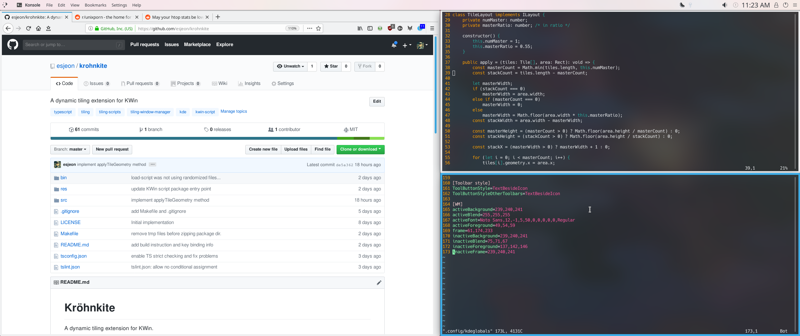
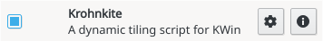

# 上游资源迁移

来源是 [Codeberg Krohnkite](https://codeberg.org/anametologin/Krohnkite)，
固定提交为 `ade1de7488cd84185f6f14efd4fba8e8b0db7ddb`。
完整源码保存在 `.repo/krohnkite`，提交同时记录在 `upstreams.json`。
下表对应这个提交的 `res/` 和 `img/`；标为原样保留的文件可直接核对字节。

## 运行时与配置

| 上游资源 | 本项目路径 | 迁移方式与用途 |
| --- | --- | --- |
| `res/shortcuts.qml` | `packages/kwin/assets/contents/ui/shortcuts.qml` | 保留 39 个快捷键处理器、名称、文字与 SPDX；仅将 25 个非空默认绑定调整为 Meta 加单键，另外 14 个保持空，由主入口加载 |
| `res/popup.qml` | `packages/kwin/assets/contents/ui/popup.qml` | 原样保留 Plasma 通知界面，由主入口加载 |
| `res/dbus.qml` | `packages/kwin/assets/contents/ui/dbus.qml` | 原样保留 KWin、指针移动和虚拟键盘 DBus 调用，由主入口加载 |
| `res/dragpreview.qml` | `packages/kwin/assets/contents/ui/dragpreview.qml` | 原样保留 Dock 拖动预览及输入透明的 Plasma 对话框，由主入口加载 |
| `res/config.xml` | `packages/kwin/assets/contents/config/main.xml` | 原样迁移到 KPackage 配置约定路径，保留 145 个配置项 |
| `res/config.ui` | `packages/kwin/assets/contents/ui/config.ui` | 原样保留 Qt Designer 配置界面，交给 KWin 通用脚本配置模块加载 |
| `res/main.qml` | `packages/kwin/assets/contents/ui/main.qml` | 迁移为 Effect 运行时入口，保留快捷键、通知、DBus、预览、配置重载与退出清理的职责；增加原生 Timer 和 DBus 回调桥 |
| `res/metadata.json` | `packages/kwin/assets/metadata.json` | 保留插件 ID、DeclarativeScript 类型、配置模块及 `ui/main.qml` 入口；更新版本与描述，列出上游作者 |
| `res/main.js` | `.repo/krohnkite/res/main.js` | 上游仅含一条 `print` 的占位文件，原件保存在源码归档；应用逻辑由构建生成的 `contents/code/krohnkite.js` 提供 |

前六项已经在重写期间迁移。除 `shortcuts.qml` 的默认绑定调整外，
其余五项与固定上游逐字节相同。默认按键映射见 [README](README.md#默认快捷键)。
所有五个上游 QML 文件都有运行时对应资源。
主入口的模块化迁移保留现有 Qt/KWin 适配行为。

`.kwinscript` 打包使用 `packages/kwin/assets/` 下的文件和生成的 JavaScript，
保留已迁移的运行时与配置资源。`metadata.json` 的
`X-Plasma-MainScript` 仍指向 `ui/main.qml`，此入口导入
`../code/krohnkite.js`。

## 文档图片

| 上游资源 | 本项目路径 | 用途 |
| --- | --- | --- |
| `img/screenshot.png` | `docs/images/screenshot.png` | 上游 README 的历史平铺界面示例，原样保存 |
| `img/conf.png` | `docs/images/conf.png` | 上游 README 中 KWin 脚本条目的配置入口示例，原样保存 |

图片用于文档和源码归档。上游与迁移后的 QML、配置文件均未引用这些 PNG，
安装包只携带运行时实际使用的资源。源码发布资产应包含上述本项目文档路径，
完整的 `.repo/krohnkite/img/` 也随固定上游源码一起归档。

历史平铺示例：

历史配置入口：

## 核对与许可

固定上游原件的 SHA-256 如下。`shortcuts.qml` 的值对应上游原始默认绑定，
不代表本项目调整后的文件；其余原样迁移资源和图片的目标文件与来源文件逐字节一致。

| 上游路径 | SHA-256 |
| --- | --- |
| `res/shortcuts.qml` | `50de3813c52df1ae8f8c7f383506c82f468bae1f01ec37ea2042f9a7ffb60f36` |
| `res/popup.qml` | `9e21a5b9ea371135bcda37956eacb9a6957b9544164b262d8d31308e7fc96e34` |
| `res/dbus.qml` | `4c27df3b26a04f25c853da555805714d8cd85538cc02ecdd31501a0864899676` |
| `res/dragpreview.qml` | `75020eada64107743dd20b4146d150e27dfd1abe8989a35a0c71ce7de0bf2929` |
| `res/config.xml` | `3ce634b53f8d7add967dd07275edc7a058d5fdc08660a21ebcfab10bf272691d` |
| `res/config.ui` | `fc9c63edb7129f73a168daa4043702e1b1a92a6a9025d783d9df4ef5360f6dce` |
| `img/screenshot.png` | `b22a29e0cf4313cb38d78cfa2f757358fd8d56a48297b705fb088105a050620d` |
| `img/conf.png` | `2f2d69eb9d85bf7ae70b8185662445de737167bf2a2dfe521b4ac53d69223e10` |

上游采用 MIT 许可证；[LICENSE](LICENSE) 保留 Eon S. Jeon（2018）与
Vjatcheslav V. Kolchkov（2024）的版权及许可声明，复制的 QML 继续保留其
SPDX 注释；拖动预览另保留原文件的 2026 Krohnkite contributors 声明。
上游图片没有单独声明图片作者或许可证，因此保留仓库许可、来源路径与完整原件。
发布资产中的归属说明见 [NOTICE](NOTICE)。
